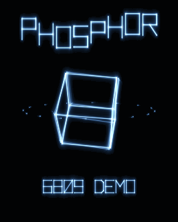
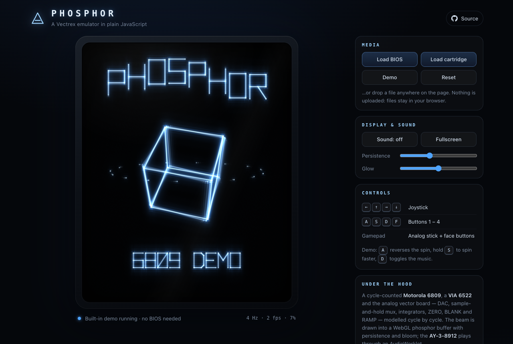

# Phosphor — a Vectrex emulator in plain JavaScript

[](https://github.com/jimmykurc/vectrex-phosphor/actions/workflows/test.yml)
[](LICENSE)


> 🇫🇷 Bienvenue ! Un émulateur Vectrex écrit en JavaScript pur, qui tourne directement dans le navigateur.

**▶ Live demo: https://jimmykurc.github.io/vectrex-phosphor/**

<p align="center">
  
</p>

The [Vectrex](https://en.wikipedia.org/wiki/Vectrex) (1982) is the only home console that drew
real vectors: no frame buffer, no pixels — a Motorola 6809 steers an electron beam
by charging analog integrators. Phosphor emulates that chain from the CPU down to
the beam, then paints the beam into a WebGL "phosphor" with persistence and glow.

It opens on an **original demo program written in 6809 assembly** for this
project, which runs without the (copyrighted) system ROM. Load your own BIOS
and cartridge images to run real software.



## Features

- **Motorola 6809 CPU** — every documented opcode on pages 0, 2 and 3, all
  addressing modes (including every indexed and indirect form), datasheet cycle
  counts, IRQ / FIRQ / NMI, SWI1-3, CWAI and SYNC.
- **VIA 6522** — ports with DDRs, timer 1 (one-shot / free-running, PB7 output),
  timer 2, the shift register (shift-out mode), CA2/CB2 manual outputs, IFR/IER.
- **Analog vector hardware** — the DAC, the sample-and-hold multiplexer
  (Y, offset, brightness, sound), X/Y integrators, ZERO, BLANK and RAMP,
  stepped every CPU cycle and turned into timestamped beam segments.
- **Phosphor rendering** — WebGL2, gaussian beam profile, half-float
  persistence buffer, two-level bloom, tone mapping, adjustable persistence
  and glow. Canvas 2D fallback.
- **AY-3-8912 sound** — tones, noise, all 16 envelope shapes, logarithmic
  levels, cycle-timestamped register writes, played through an AudioWorklet.
  The DAC sound path (mux channel 3) is mixed in too.
- **Input** — keyboard and the Gamepad API; the analog stick feeds the
  joystick pots that the BIOS reads through the DAC comparator.
- **Bring your own ROMs** — file pickers or drag and drop, auto-detection
  of BIOS vs cartridge. Nothing leaves the browser.
- **No build step, no dependencies** — ES modules served as static files.
- **Tests** — 67 `node --test` tests: CPU flags, addressing modes, cycle counts,
  interrupts and small programs; VIA timers, IRQs and shift register; PSG;
  vector generator; the assembler; and an end-to-end run of the demo.

## Architecture

```
 cartridge ROM ─┐
 system ROM ────┼── 6809 CPU ── VIA 6522
 1 KB RAM ──────┘                │ port A ──▶ DAC ──┬──▶ X integrator ──────────┐
                                 │                  └──▶ S/H mux: Y · offset · Z ┼──▶ beam segments ──▶ WebGL phosphor
                                 │ PB0-PB2  mux enable / select                  │
                                 │ PB7      RAMP  (driven by timer 1)            │
                                 │ CA2      ZERO                                 │
                                 │ CB2      BLANK (shift register output) ───────┘
                                 │ port A + PB3/PB4 ──▶ AY-3-8912 ──▶ AudioWorklet
                                 │                       ▲ reg 14: buttons
                                 └ PB5 ◀── comparator ◀── joystick pots (keyboard / gamepad)
```

| Address       | Device                                   |
| ------------- | ---------------------------------------- |
| `0000-7FFF`   | Cartridge ROM                            |
| `C800-CFFF`   | 1 KB RAM (mirrored)                      |
| `D000-D7FF`   | VIA 6522 (mirrored every 16 bytes)       |
| `E000-FFFF`   | System ROM — your BIOS, or the demo      |

How a line gets drawn, in one paragraph: the program writes a Y value to the DAC
and latches it into the Y sample-and-hold through the analog mux, writes the X
value to the DAC (which feeds the X integrator directly), sets the beam on through
the VIA shift register (BLANK), then loads VIA timer 1. While timer 1 runs, PB7
holds RAMP low and both integrators ramp at a rate proportional to their input —
so the timer count is the vector's *scale*. `vector.js` reproduces exactly that,
cycle by cycle, and emits a segment whenever velocity or brightness changes.

Frames are paced the way the BIOS paces them: each displayed frame runs until
the program re-arms VIA timer 2 (its 50 Hz refresh timer), so every frame handed
to the renderer holds exactly one full refresh — no beating against a 60 or 120 Hz
display.

```
index.html, style.css      single-page UI
src/
  cpu/cpu6809.js           Motorola 6809 core
  hw/via6522.js            VIA 6522
  hw/ay38912.js            AY-3-8912 PSG
  hw/vector.js             DAC, mux, integrators -> beam segments
  vectrex.js               memory map and wiring
  render/phosphor.js       WebGL2 phosphor renderer (+ Canvas 2D fallback)
  audio/                   Web Audio output (AudioWorklet)
  input.js                 keyboard + Gamepad API
  demo/demo-rom.js         assembled demo (generated)
demo/demo.asm              the demo, in 6809 assembly
tools/
  asm6809.js               two-pass 6809 assembler (full instruction set)
  build-demo.js            builds src/demo/demo-rom.js from demo/demo.asm
  capture.js               headless Chrome smoke test + screenshot
  capture-gif.js, gif.js   deterministic GIF recording (dependency-free encoder)
test/                      node --test suites
```

## The built-in demo game

`demo/demo.asm` is an original program (MIT) that sits in the system ROM slot
and programs the VIA directly — no BIOS routines. Each 50 Hz frame it rotates and
projects a cube with signed 8×8 multiplies and lookup tables (sine, perspective),
builds a vector list on the fly, prints text with its own stroke font and plays
a PSG arpeggio, all within the 30 000-cycle frame budget.

The title screen turns into a small shooting game: the spinning cube drifts
down towards your ship; hit it before it lands. Each hit scores a point and
the next cube comes faster. Buttons are read through the PSG, the joystick
through the DAC comparator, like on the real machine.

| Key | Effect |
| --- | --- |
| <kbd>A</kbd> or <kbd>F</kbd> (button 1 / 4) | start the game, then fire |
| <kbd>←</kbd> <kbd>→</kbd> (joystick) | move the ship |
| <kbd>S</kbd> (button 2) | spin the cube faster while held |
| <kbd>D</kbd> (button 3) | music on / off (click **Sound** first — browsers need a gesture) |

Rebuild it after editing: `node tools/build-demo.js`.

## Run it locally

```sh
git clone https://github.com/jimmykurc/vectrex-phosphor.git
cd vectrex-phosphor
python3 -m http.server 8000
# open http://localhost:8000/
```

Any static file server works; ES modules just need `http://` rather than `file://`.

**Controls:** arrow keys = joystick, <kbd>A</kbd> <kbd>S</kbd> <kbd>D</kbd> <kbd>F</kbd>
(or <kbd>1</kbd>–<kbd>4</kbd>) = buttons 1–4. A first gamepad is player 1, a second one player 2.

## Tests

```sh
node --test                    # 67 tests, Node 22+ (developed on Node 24)
node tools/build-demo.js --check
node tools/capture.js http://localhost:8000/ shot.png   # headless Chrome smoke test
```

## Limitations

Honest list of what is not there (yet):

- No bank switching for cartridges larger than 32 KB.
- The analog side is idealised: no integrator drift, no DAC settling delay,
  ZERO is instantaneous. Software that depends on those quirks may look off.
- VIA handshake modes, CA1/CB1 interrupts, T2 pulse counting and shift-in modes
  are not emulated (the Vectrex does not use them for normal operation).
- No light pen, 3D Imager or overlays.
- Compatibility with commercial cartridges has not been systematically tested;
  this repository is developed and tested against its own demo program.

## ROMs, BIOS and legal note

This repository contains **no ROM or BIOS images** and no code, graphics, names
or sounds taken from any game. The demo program, its font and its music are
original work released under the MIT license.

To run Vectrex software you need a BIOS image (8 KB system ROM) and cartridge
images that you are legally entitled to use. Files you load are read locally by
your browser and are never uploaded.

"Vectrex" is a trademark of its respective owner. This project is an independent
hobby emulator and is not affiliated with or endorsed by them.

## License

[MIT](LICENSE) © 2026 Jimmy Kurc
